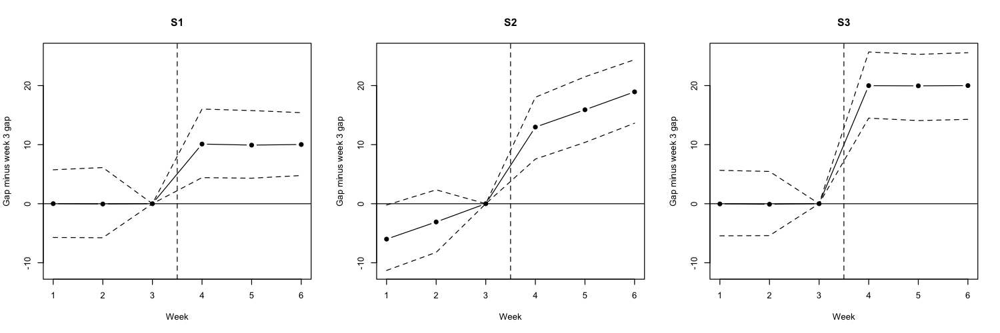

# When does difference-in-differences recover an ad campaign's effect?

A simulation in R. A campaign runs in 50 of 100 cities after week 3 of 6, and its true effect is set to +10 sales per city-week. Because the true answer is known, I can check whether difference-in-differences recovers it, and how it fails when its main assumption is broken.

## Result in one paragraph

When parallel trends hold (S1), the estimate averages 10.04 over 1,000 datasets, and the 95% interval from a model with city and week fixed effects contains the true +10 in 95.7% of them. When the advertised cities were already growing faster (S2) or an unrelated shock hit them as the campaign started (S3), the estimates average 18.98 and 20.00, and the same intervals contain +10 in 0% of datasets. The standard error stays near 1.6 in all three scenarios. The estimate is just as precise and no longer right. A standard error measures noise, not whether an assumption holds.

## Design

- 100 cities (50 advertised, 50 comparison), weeks 1 to 6, campaign starts after week 3.
- Sales = 100 + 5 x week + city effect + 10 x advertised x post + noise. The city effect is Normal(0, 15^2), drawn once per city. The noise is Normal(0, 10^2), drawn fresh for every city-week.
- S1: parallel trends hold. S2: advertised cities also gain 3 extra units per week (3 x advertised x week). S3: an unrelated +10 shock starts with the campaign (10 x advertised x post).
- Model 1 is lm(sales ~ D * Post), with no fixed effects. Model 2 is lm(sales ~ D:Post + factor(city) + factor(week)). In this balanced panel with one start date, both give the same estimate as the hand calculation from the four group averages. Estimator A compares weeks 3 and 4 only.
- 1,000 datasets per scenario, one random stream, seed 2026 set once. Sessions 2 and 3 first built a single dataset by hand: the four group averages gave 9.54, and both regressions gave the same number.

## Results (1,000 datasets per scenario)

| | S1 | S2 | S3 |
|---|---|---|---|
| Mean of the estimate | 10.042 | 18.981 | 19.998 |
| SD of the estimate | 1.620 | 1.703 | 1.602 |
| Mean standard error, Model 2 | 1.631 | 1.646 | 1.632 |
| Mean standard error, Model 1 | 2.996 | 3.058 | 3.000 |
| Model 2 intervals containing +10 | 95.7% | 0% | 0% |
| Model 1 intervals containing +10 | 100% | 4.6% | 0.5% |
| Estimator A, mean (SD) | 10.004 (2.845) | 13.012 (2.758) | 20.002 (2.878) |
| Pre-campaign gap, mean (SD) | 0.123 (3.043) | 6.050 (3.354) | 0.219 (3.220) |

Event study: mean gap between advertised and comparison cities in each week, minus the week 3 gap.

| | Week 1 | Week 2 | Week 3 | Week 4 | Week 5 | Week 6 |
|---|---|---|---|---|---|---|
| S1 | 0.01 | -0.05 | 0 | 10.10 | 9.92 | 10.02 |
| S2 | -6.00 | -3.09 | 0 | 12.97 | 15.91 | 18.94 |
| S3 | -0.04 | -0.09 | 0 | 19.99 | 19.96 | 20.00 |



Solid line: mean over 1,000 datasets. Dashed lines: 2.5th and 97.5th percentiles. Vertical dashed line: campaign start.

## What I take from it

1. **Noise averages out, bias does not.** Across 1,000 datasets the estimate settles on its expected value, but in S2 and S3 that value is 19 and 20, not 10. More datasets make the average steadier, not more accurate.
2. **Model 1's standard error is nearly twice Model 2's** (about 3.0 against 1.6). It treats repeated observations of the same city as unrelated and leaves the city effects in its error, so in S1 its intervals contain +10 every time, which is too safe. Standard errors clustered by city are the usual remedy and are not implemented here.
3. **A pre-trend check catches S2 but not S3.** In S2 the weeks before the campaign slope (-6, -3, 0). In S3 they look like S1, because the shock enters exactly like the ad effect, so no analysis of this data can separate them. That needs outside knowledge of what else happened when the campaign started.
4. **The choice of comparison changes the answer under S2.** Estimator A (weeks 3 and 4, one week apart) gives 13, and the six-week estimate (averages three weeks apart) gives 19, because the extra growth accumulates with the distance between the compared periods.

## Predictions and where they missed

Predictions were committed before the code that tests them was run.

| Session | What it tests | Predictions committed |
|---|---|---|
| 1 | Specification, event-study values for S1, S2 and S3 | ea87761 |
| 2 | One dataset, four group averages | 0f82542 |
| 3 | Model 1 and Model 2 on the same dataset | 6029d27 (same commit as the code, committed before the run) |
| 4 | S1, 1,000 datasets | fce3428 (the code measuring the pre-campaign gap was added in 72f52ff, before the run) |
| 5 | S2 and S3, 1,000 datasets each | 285c598 |
| 6 | Event study | Session 1 predictions |

- Session 2: the difference-in-differences from one dataset was 9.54 against a predicted 10. All four group averages were inside my predicted band.
- Session 4: nine of ten results were inside the predicted ranges. The SD of the pre-campaign gap was 3.043 against a predicted 3.2. The theoretical value is 3.21, and fresh datasets later gave 3.354 (S2) and 3.220 (S3), so I treat the first as chance.
- Session 5: 19 of 20 results were inside their ranges. The S3 mean pre-campaign gap was 0.219 against a range of -0.2 to 0.2, about 2.1 standard errors from 0, and S3's added term is 0 before the campaign.
- Session 6: all 18 weekly means were within 0.10 of the Session 1 predictions.

## Limitations

- This is a simulation. It shows how the method behaves under the assumptions I chose, not how any real campaign behaved.
- The effect is constant, there is one start date, the panel is balanced, and the noise is normal and independent across weeks. Staggered adoption and noise that persists within a city are not covered.
- The event study is the means version. In this balanced design it equals the week-by-week regression coefficients.
- Results reproduce with the same code, seed and R version (4.5.2).

## Reproduce

Base R only, no packages. From this folder:

```
Rscript --vanilla simulate.R
```

It takes about 15 seconds, prints the results for every session and writes `figures/event_study.png`. `SPEC.md` holds the specification and `PREDICTIONS.md` the predictions. `CLAUDE.md` holds the working rules and `AI_USE_LOG.md` the session log.

## AI assistance

I learned the concepts step by step with an AI tutor (Claude) in a separate chat. The R code in `simulate.R` was written by Claude Code under the working rules in `CLAUDE.md`, with each step approved by me. I wrote the specification and my first predictions (`SPEC.md` and the Session 1 section of `PREDICTIONS.md`). This README was drafted with the AI tutor, and I reviewed and approved it. `AI_USE_LOG.md` records what the AI did in each session.
